# Dreamscape

**Your brain deletes your dreams. Dreamscape keeps them.**

Tell your phone a dream when you wake up. A few minutes later it hangs on your wall as a painting, made in private on 0G. Overnight, your 0G credit's leftovers become a comic, a poster and a moving portrait. Every piece is a name you own on ENS, and you can sell editions or let a friend visit.

**[Live app](https://dreamscape.hacklabs.in)** · **[Every receipt, with explorer links](https://dreamscape.hacklabs.in/proof.html)** · **[Android app](#phone-app)**

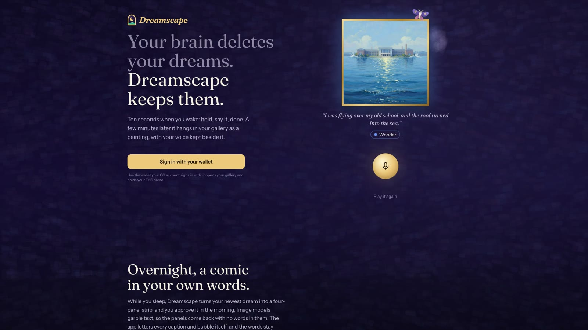

Built at ETHGlobal Mumbai, November 5–7, 2026. Scaffolded with `create-next-app` and `forge init`; the Android project in `mobile/android` was generated by Capacitor. The first two commits are generated: the `create-next-app` template, then the dependency pins, whose size is `pnpm-lock.yaml`, written by pnpm. Everything after that was written during the event in small commits.

## The problem

Two things vanish every night.

- **Dreams, by breakfast.** You wake up with a vivid one, and an hour later it's gone. Writing it down takes effort nobody has at 7 am.
- **0G credit, at midnight UTC.** iAI holders get fresh compute credit every day, and whatever isn't spent expires.

Dreamscape turns the first into a ten-second habit and spends the second on it.

## What it does

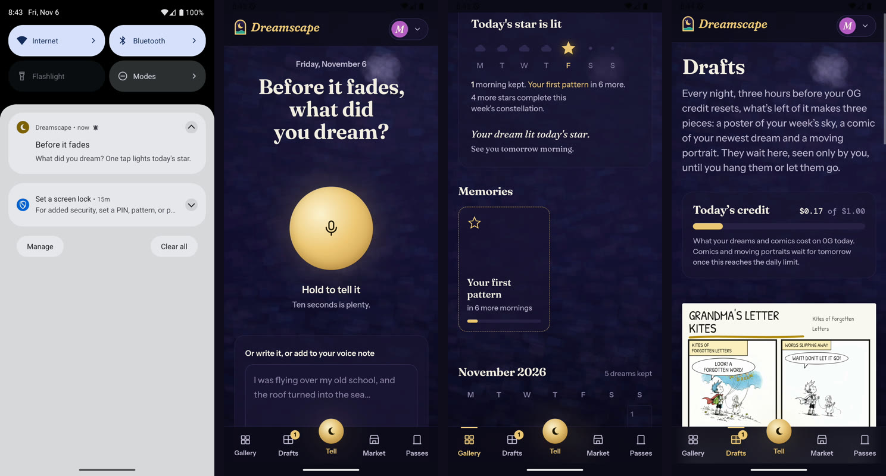

1. **Morning, ten seconds.** Your phone nudges you at the time you usually wake. Hold the gold button and say the dream, or type one line, and tap how it felt.
2. **A few minutes later.** 0G Private Computer hears it, reads its themes and paints it, all sealed. The painting hangs on your wall, with your voice kept beside it.
3. **Three hours before the credit resets.** What's left of today's credit makes three pieces: a poster of your week's sky, a four-panel comic of your newest dream, and a moving portrait. They wait in Drafts until you hang them or let them go.
4. **Every morning after.** Opening the app lights a star, the month fills in, and a sealed Morning Note compares your week with what most people dream.
5. **Whenever you like.** Sell numbered editions for USDC, give an edition to a friend, or share your whole gallery with a pass.

| Telling a dream | Minutes later, on the wall |
|---|---|
| 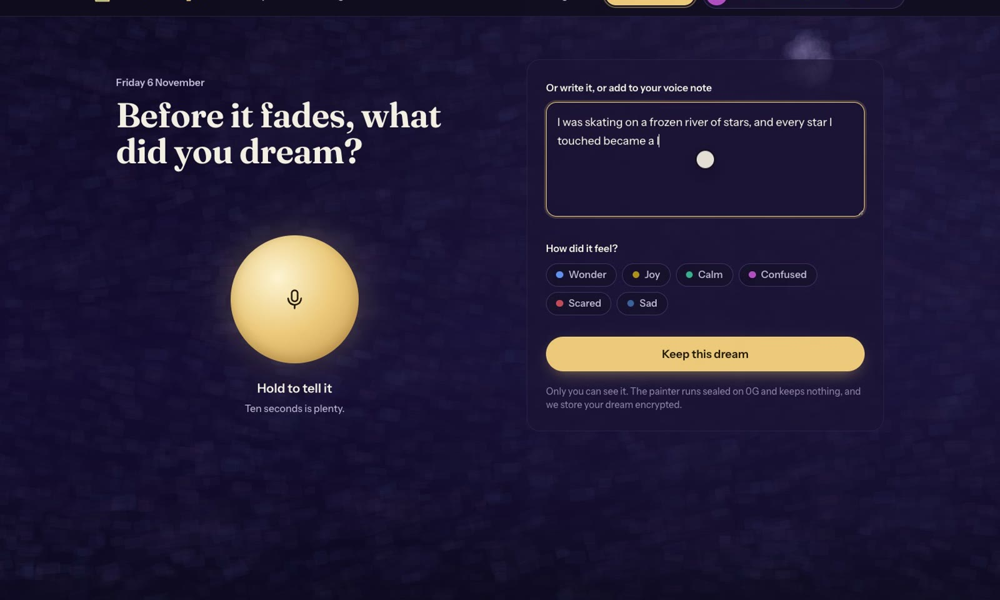 | 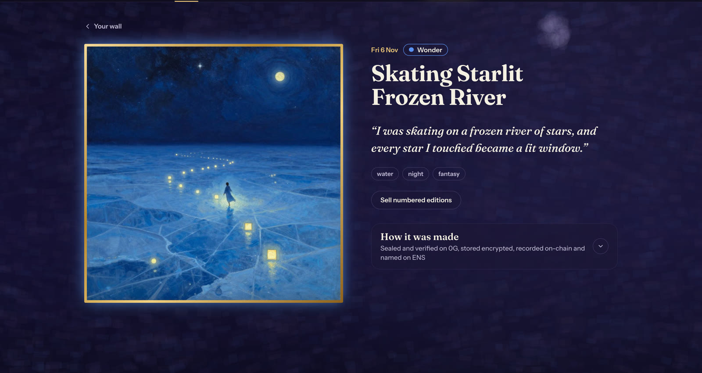 |
| **The wall: a calendar of dreams** | **How it was made: request IDs, TEE checks, storage roots** |
| 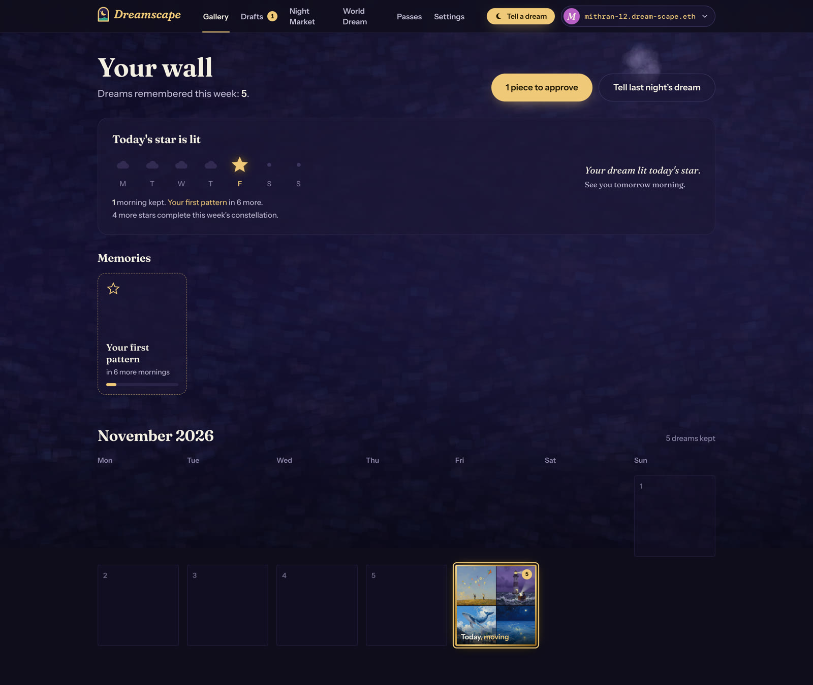 | 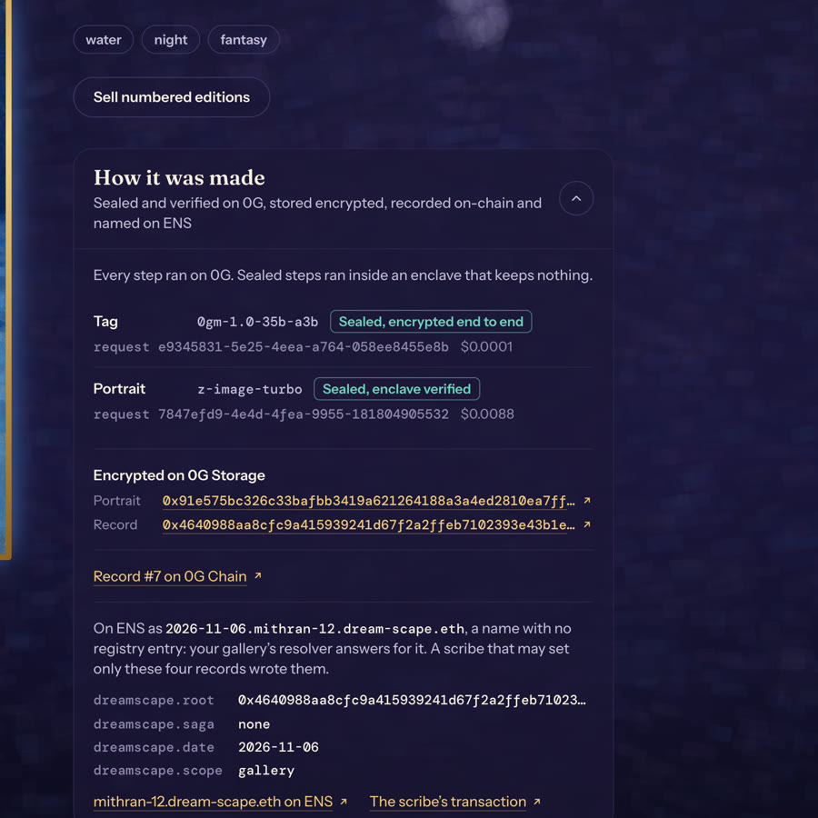 |
| **Last night's comic, poster and moving portrait** | **An edition for sale** |
| 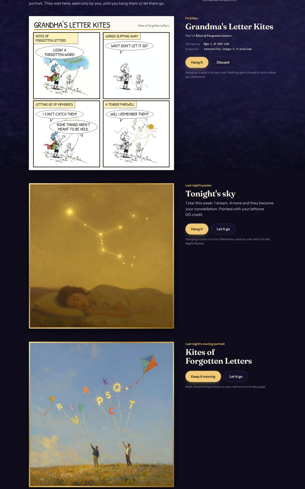 | 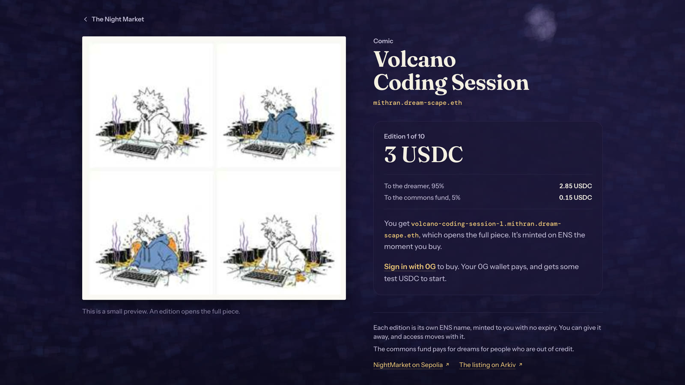 |
| **Collected: what your wallet holds** | **A friend visiting with a pass** |
| 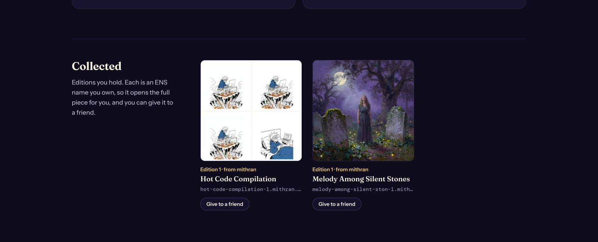 | 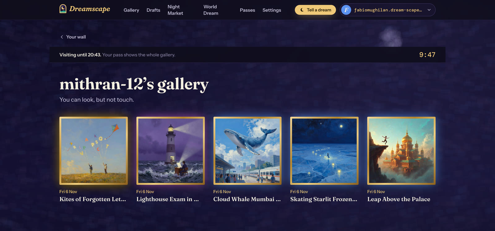 |

## How it works

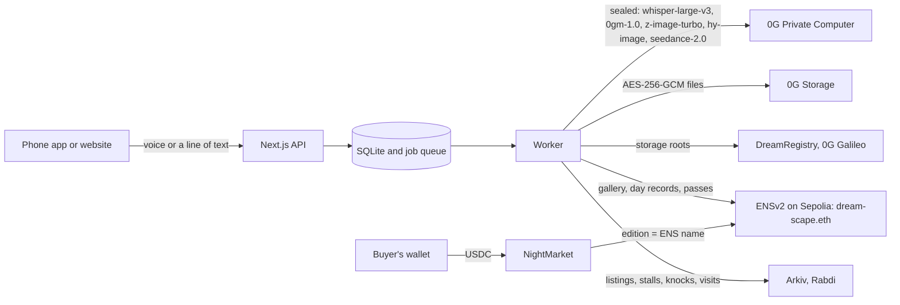

**0G** is the reason the app exists. Every dream is heard by `whisper-large-v3`, read by `0gm-1.0-35b-a3b` and painted by `z-image-turbo` on 0G Private Computer in private trust mode, and every step keeps its `x_0g_trace` request ID, TEE result and cost. "Sign in with 0G" makes a scoped key on the dreamer's own account, so their iAI credit pays: one dream took a balance from $4.91 to $4.90. Files go to 0G Storage encrypted, and DreamRegistry on 0G Galileo anchors them. Without 0G, Dreamscape can't hear, read or paint a dream in private, keep it encrypted, or pay for tonight's art. Details and receipts: [`docs/0g.md`](docs/0g.md).

**ENS** is how a dreamer owns their gallery. Each gallery is `name.dream-scape.eth`, registered to the dreamer's wallet with its own resolver. Each day is a wildcard name under it, `2026-11-06.name.dream-scape.eth`, whose `dreamscape.root` text record points at that day's dream on 0G Storage. Editions and passes are names too, so they move between wallets like any token. Details: [`docs/ens.md`](docs/ens.md).

**Arkiv** holds what the public needs to see without our server: listings searchable by theme, kind and price, vendor stalls, and knocks and visits that expire by themselves. Details: [`arkiv/how-you-use-arkiv.md`](arkiv/how-you-use-arkiv.md).

## Proof

Real transactions from the live app. The full list is on the [receipts page](https://dreamscape.hacklabs.in/proof.html).

| What happened | Where | Link |
|---|---|---|
| A dream anchored, painted on the dreamer's own credit (record #7) | 0G Galileo | [`0x018a5de8…e90f`](https://chainscan-galileo.0g.ai/tx/0x018a5de82ff01b3ba4d431eba22e303fcee6d23ba4334e71821626296933e90f) |
| Its encrypted record | 0G Storage | [`0x4640988a…e58e`](https://dreamscape.hacklabs.in/api/storage/0x4640988aa8cfc9a415939241d67f2a2ffeb7102393e43b1e878b90eb93e1f58e) |
| That day's ENS record pointing at it | Sepolia | [`0xea5b188b…5240`](https://sepolia.etherscan.io/tx/0xea5b188bd27f6209f96603bc0293530fbd19eca4040bf0823f5e635051625240#eventlog) |
| An edition bought from another wallet | Sepolia | [`0x4a82639e…a079`](https://sepolia.etherscan.io/tx/0x4a82639e708b4166196371cc6ff8b55c86f3815a3b7c40649f0413530806a079) |
| An edition given to a friend | Sepolia | [`0xc15bbca6…8bb9`](https://sepolia.etherscan.io/tx/0xc15bbca62225e97dc25159fe9b686ec2c3e561bc47da8ebca23f2f0db66b8bb9) |
| A gallery pass minted to a friend | Sepolia | [`0x943e3f58…91bf`](https://sepolia.etherscan.io/tx/0x943e3f58e5716ba9c3052c0d8af3a62f228b0cd120977048f4928620388791bf) |
| A listing, searchable by theme | Arkiv | [`0x535fd19b…f4d0`](https://rabdi.explorer.arkiv.network/entity/0x535fd19bdb13b413a248fab8faa01dca975402bf932bc57029e0691cc6aff4d0) |

0G request IDs appear on no public explorer, so each piece's page shows them under "How it was made", and DreamRegistry anchors the storage roots on 0G Chain.

## Deployed

| Contract | Network | Address |
|---|---|---|
| `DreamscapeRegistry` (names under `dream-scape.eth`) | Ethereum Sepolia | [`0xCB61EabBFdb446a561A29814312F5ECB542d5C87`](https://sepolia.etherscan.io/address/0xCB61EabBFdb446a561A29814312F5ECB542d5C87) |
| `NightMarket` (checkout in Circle's USDC, and editions) | Ethereum Sepolia | [`0xD40165F204E4E1f8014d331e1d4c2CFe1eF904bC`](https://sepolia.etherscan.io/address/0xD40165F204E4E1f8014d331e1d4c2CFe1eF904bC) |
| `DreamRegistry` (one record per kept dream) | 0G Galileo | [`0x1622A080E8c5c47b12CB6364D248228c7bF86B66`](https://chainscan-galileo.0g.ai/address/0x1622A080E8c5c47b12CB6364D248228c7bF86B66) |
| USDC (Circle, testnet) | Ethereum Sepolia | [`0x1c7D4B196Cb0C7B01d743Fbc6116a902379C7238`](https://sepolia.etherscan.io/address/0x1c7D4B196Cb0C7B01d743Fbc6116a902379C7238) |

## Tech stack

- **App:** Next.js 16 (App Router, Turbopack), React 19, Tailwind v4, SQLite through `node:sqlite`, and a worker that runs every model call, upload and transaction as a retried job.
- **0G:** the Router API (`router-api.0g.ai/v1`, OpenAI-compatible, private trust mode), `@0gfoundation/0g-storage-ts-sdk` 1.2.13, `@0gfoundation/0g-pay-sdk` 0.4.0, and 0G's Privy app for Sign in with 0G.
- **Chains:** Solidity contracts built and tested with Foundry, `viem` 2 and `ethers` 6, ENSv2 on Sepolia, Circle's test USDC.
- **Arkiv:** `@arkiv-network/sdk` 1.0.1 on the Rabdi testnet.
- **Phone:** Capacitor 8 for Android, with `@capacitor/local-notifications` for the morning reminder.

## Run it

Needs Node 22 or later, pnpm and Foundry.

```bash
pnpm install
```

```bash
cp .env.example .env.local
```

Fill in `.env.local`, then:

```bash
pnpm dev
```

```bash
pnpm worker
```

```bash
pnpm check
```

`pnpm check` confirms the ENS deployment, the Arkiv network and the 0G router are reachable. Open http://localhost:3000. The 0G credit page (`/0g`) uses 0G's own sign-in, which 0G allows on `localhost:3000` only, so run the dev server on that port. The live site signs in with the same wallet through a wallet-only Privy app.

Contracts:

```bash
cd contracts && forge build && forge test
```

## Phone app

`mobile/` is an Android app made with Capacitor. It opens the live site, so the gallery, sign-in and recording run the same code as the web. It adds two things a browser tab can't do: it asks for the microphone like any app, and it schedules a morning reminder on the phone at your usual wake time. Tapping the reminder opens Tell.

It needs Android Studio, for the Android SDK and Java 21:

```bash
cd mobile && pnpm apk
```

The APK lands in `mobile/android/app/build/outputs/apk/debug/`. 0G's sign-in accepts only `localhost`, so for a demo build with `DREAMSCAPE_URL=http://localhost:3000` and connect the phone over USB:

```bash
adb reverse tcp:3000 tcp:3000
```

## Tests

Each one runs against the real contracts on a local anvil fork of Sepolia, or on a local Arkiv node in Docker, so nothing touches a live network.

| Command | What it proves |
|---|---|
| `pnpm ens:fork-test` | The name base: a gallery, a wildcard day record read through the Universal Resolver, and a scribe that can't touch anything else |
| `pnpm market:fork-test` | A whole sale: list, pay in USDC, the edition's ENS name, the 95/5 split, and a transfer to a friend |
| `pnpm passes:fork-test` | Passes and visits: grant, scope, knock, let in, expiry and revoke |
| `pnpm commission:fork-test` | A paid vendor-agent commission from escrow to delivery |
| `pnpm market:arkiv-test` | Listings written and searched on Arkiv by theme, kind and price |

## Arkiv query

Listings with the water theme at or under 10 USDC, cheapest first:

```bash
curl https://rpc.rabdi.db-chain.testnet.arkiv.network -H 'content-type: application/json' --data @- <<'EOF'
{"jsonrpc":"2.0","id":1,"method":"arkiv_query","params":[
 "arkiv.schema = str('dreamscape.listing.v1') AND th_water = true AND priceUsdc <= u64(10000000) AND $creator = addr(0x55fF4c231f90585a06dfC877af6D3001d9cf1496) ORDER BY priceUsdc:u64 ASC",
 {"select":{"key":true,"owner":true,"creator":true,"expiresAt":true,"attributes":true},"limit":"0xa"}]}
EOF
```

The server wallet `0x55fF4c231f90585a06dfC877af6D3001d9cf1496` writes each listing, stall, knock and visit, then hands it to the dreamer, buyer or visitor it belongs to. The entities, their attributes and expiry are in [`arkiv/schema.md`](arkiv/schema.md).

## Repository layout

| Path | What's there |
|---|---|
| `src/app/` | Pages and API routes |
| `src/lib/server/` | The pipeline, 0G clients, ENS, Arkiv, market, passes and the nightly run |
| `worker/` | The job worker |
| `contracts/` | `DreamRegistry` and `NightMarket` with Foundry tests |
| `mobile/` | The Android app |
| `scripts/` | Fork tests, checks and setup scripts |
| `docs/`, `arkiv/` | Partner write-ups and the Arkiv schema |

## How it was built

Built by the team during the event, with an AI coding assistant to help write and review code. How it was used is in [`AI_USE.md`](AI_USE.md).

## License

MIT
